# Uptime Tracker: Data Flow Diagrams

| | |
|---|---|
| **Version** | 0.1 (draft) |
| **Status** | For review |
| **Diagram format** | Mermaid (renders in VS Code with a Mermaid preview extension, GitHub, and most Markdown tools) |
| **Companion docs** | `app_concept.md`, `schema.md`, `api_contract.md` |
| **Next docs** | Security and reliability plan, infrastructure plan, `openapi.yaml` |

---

## 1. Purpose and scope

This document shows **how data moves** through Uptime Tracker: where it enters, which process transforms it, where it is stored, and who consumes it. It is the bridge between the data model (`schema.md`), the API (`api_contract.md`), and the code that will be built.

It covers:

- A context diagram and a system-level data flow diagram (DFD)
- Detailed flows for each major process: checking, detection, incidents, alerting, ingestion, status pages, reports, webhooks, authentication
- State machines for the entities whose status changes over time
- Where each kind of data lives, how long it is kept, and what happens when parts fail
- Timing targets for detection and alerting

Every flow names the schema tables and API endpoints involved, so a developer can trace a feature from user action to database row.

---

## 2. Notation and conventions

| Symbol (Mermaid) | Meaning |
|---|---|
| Rectangle `["..."]` | External entity (a person or a system outside Uptime Tracker) |
| Rounded `("...")` | A process that transforms data |
| Cylinder `[("...")]` | A data store |
| Arrow with label | A data flow, labelled with **what** moves |
| Circle `(("..."))` | The whole system (context diagram only) |

Conventions used throughout:

- **D1 to D6** name the data stores (section 4). **P1 to P9** name the main processes.
- Times are UTC. "Round" means one scheduled check tick across all assigned regions for one platform.
- Domain events travel on the **event stream** (NATS or Kafka, decision pending). State changes in PostgreSQL publish events through a **transactional outbox**, so a database change and its event can never disagree (section 5.13).
- A flow that crosses a trust boundary (internet to us, or us to the internet) is marked in the security notes under the diagram.

---

## 3. Level 0: Context diagram

The whole system as one box, with everything it exchanges with the outside world.

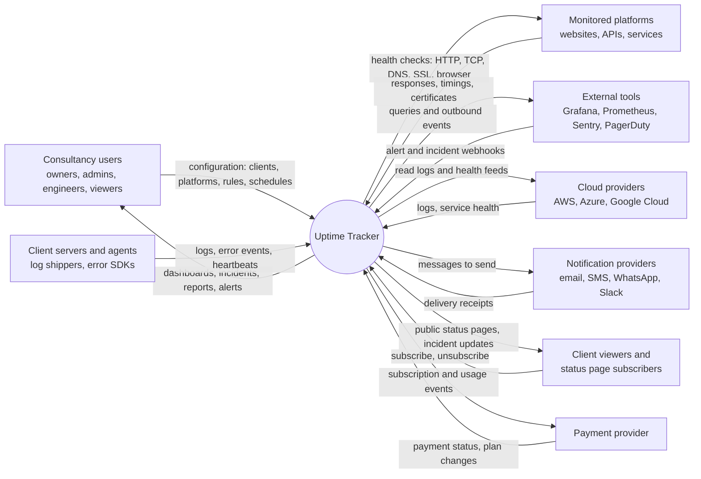

**Trust boundaries crossed:** every arrow touching an external entity. Inbound data is authenticated (keys, tokens, signatures) and validated before it reaches any process. Outbound requests to monitored platforms and webhook targets are restricted to public addresses (see `api_contract.md` section 15.2).

---

## 4. Level 1: System data flow diagram

### 4.1 Processes and data stores

| ID | Name | Responsibility | Main tables or interfaces |
|---|---|---|---|
| **P1** | Configuration management | Accounts, clients, platforms, rules, channels, schedules | Management API, `organizations` through `alert_rules` |
| **P2** | Scheduling and probing | Decide when checks are due, run them from regions | `platforms`, `platform_regions`, probe fleet |
| **P3** | Evaluation and detection | Turn raw results into state changes and anomalies | `platform_state`, `no_data_periods` |
| **P4** | Incident management | Open, update, resolve incidents | `incidents`, `incident_platforms`, `incident_updates` |
| **P5** | Alerting and notification | Match rules, escalate, send, record delivery | `alert_rules`, `alerts`, `notifications`, `escalation_*`, `on_call_*` |
| **P6** | Client data ingestion | Receive, mask, parse, store logs and errors | Ingestion API, `ingestion_sources`, `error_groups` |
| **P7** | Publishing and reporting | Status pages, subscriber updates, SLA reports | `status_pages`, `reports`, `report_schedules` |
| **P8** | Integrations | Inbound and outbound connections to other tools | `integrations`, `integration_mappings`, webhooks |
| **P9** | Billing and limits | Plan enforcement, usage metering | `subscriptions`, `usage_records` |

| ID | Store | Technology | Holds |
|---|---|---|---|
| **D1** | Configuration database | PostgreSQL | All business data (`schema.md`) |
| **D2** | Check results | TimescaleDB hypertable | `check_results`, `check_results_daily` |
| **D3** | Log and event store | ClickHouse or Loki | Raw logs and error events |
| **D4** | Event stream | NATS or Kafka | In-flight check results, events, jobs |
| **D5** | Cache and counters | Redis | Auth lookups, rate limits, heartbeat deadlines, public status cache |
| **D6** | Object storage | S3-compatible | Report PDFs, exports |

### 4.2 Diagram

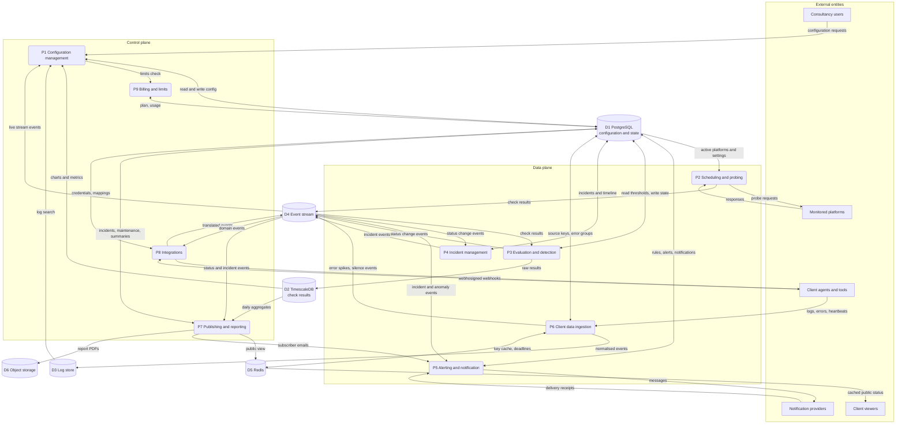

---

## 5. Level 2: Detailed flows

### 5.1 Check pipeline (P2)

How a check goes from "due" to a stored result.

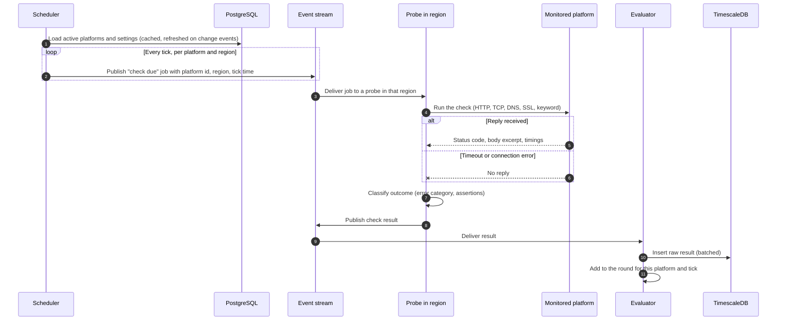

**Notes**

- **Scheduling is spread out.** Each platform gets a stable random offset within its interval, so thousands of checks do not all fire at the same second.
- **Jobs are idempotent.** The job carries a tick time. If a probe crashes and the job is redelivered, a duplicate result is discarded using the primary key `(platform_id, probe_region_id, checked_at)`.
- **Configuration secrets** (such as authentication headers) are delivered to the probe encrypted for that probe only, and never written to logs.
- **Safety.** The probe resolves the target and rejects private, loopback, link-local, and cloud-metadata addresses before connecting, and checks again at connect time.
- **Tables touched:** `platforms`, `platform_regions` (read), `check_results` (write).

### 5.2 Evaluation and detection logic (P3)

This is the most important logic in the product. It decides when a platform counts as down.

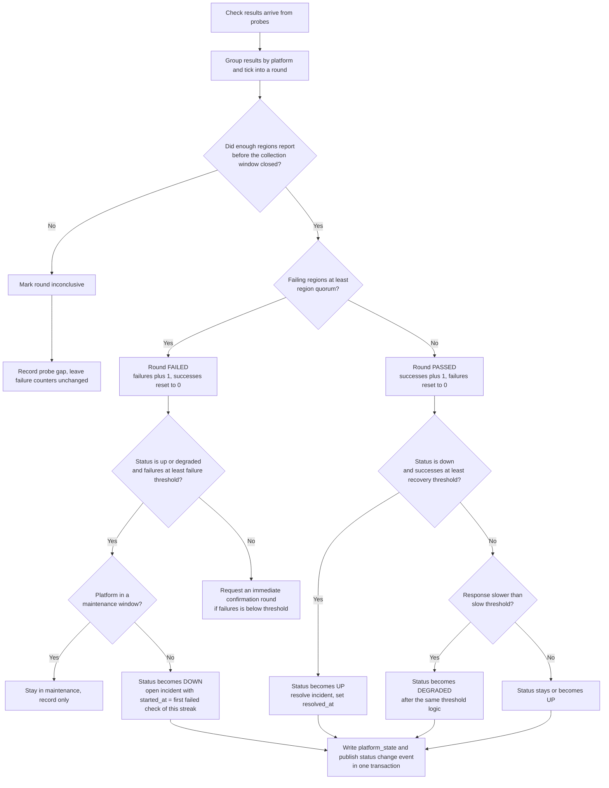

**Rules that make detection trustworthy**

1. **A round, not a single check, is the unit.** One platform is checked from several regions per tick. The round fails only when **at least `region_quorum` regions** fail it. One region's network problem never counts as downtime.
2. **Missing results are not failures.** If fewer than `region_quorum` regions reported, the round is inconclusive and counters do not move. The gap is recorded, because a silent probe is our problem, not the client's.
3. **Confirmation rounds shorten detection.** After the first failed round, the evaluator asks the scheduler for immediate extra rounds, spaced about 10 to 15 seconds apart, instead of waiting for the next full interval. This keeps false-alarm protection (several rounds) without a multi-minute delay.
4. **`started_at` is honest.** An incident's `started_at` is the timestamp of the first failed check in the failing streak, not the moment it was confirmed. `detected_at` records confirmation.
5. **State change and event are atomic.** `platform_state` is updated, the incident is opened or closed, and the outbox event is written in **one database transaction**.
6. **Degraded** follows the same threshold logic, using `slow_threshold_ms`.
7. **Maintenance** suppresses incident creation and alerts. Checks still run and results are still stored.

**Tables touched:** `platform_state`, `incidents`, `incident_platforms`, `incident_updates`, `no_data_periods`, `outbox_events` (new, section 12).

### 5.3 Anomaly detection (P3, extension)

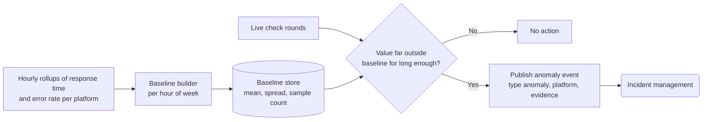

Anomaly detection starts with statistical baselines (mean and spread by hour of week). A model-based version can replace the baseline builder later without changing anything downstream, because the output is the same anomaly event. **Needs a store for baselines** (section 12).

### 5.4 Incident lifecycle (P4)

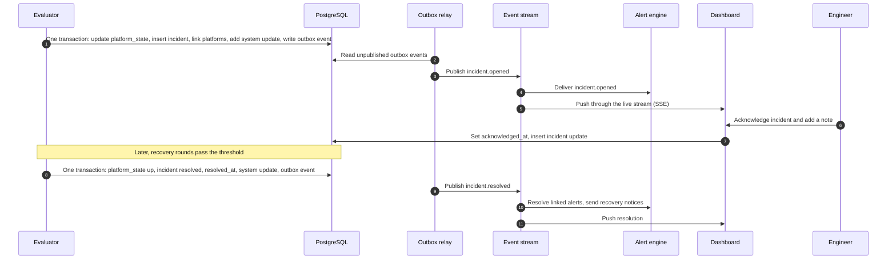

**Rules**

- Incident numbers come from `next_org_number()` inside the creating transaction, so they are gap-free per organization.
- A manual incident follows the same path from step 5 onward, with `source = manual`.
- If a platform fails again within the recovery window, the **same incident stays open** rather than creating a new one every minute.
- **Tables touched:** `platform_state`, `incidents`, `incident_platforms`, `incident_updates`, `organization_counters`.

### 5.5 Alerting and escalation (P5)

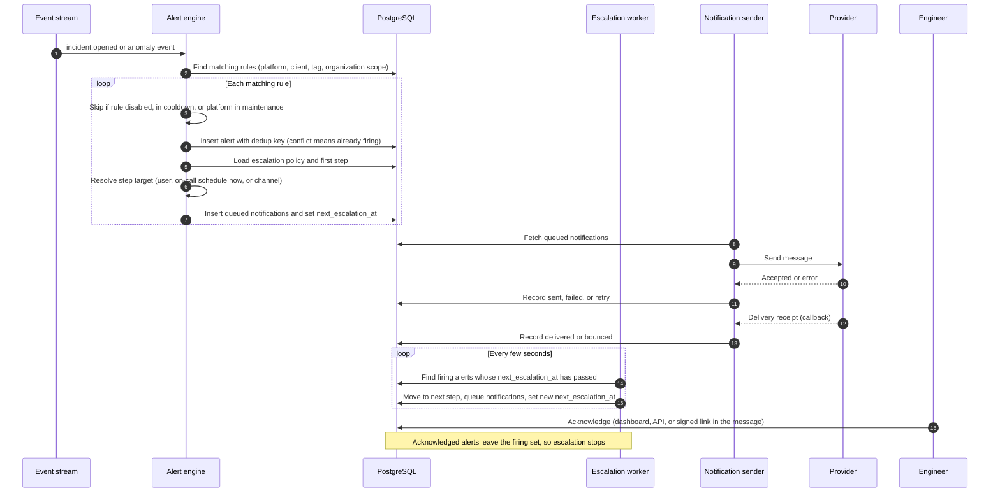

**Rules**

- **Deduplication.** The `alerts_active_dedup_uq` index makes a second identical alert fail to insert, so one outage produces one alert, not fifty.
- **Failure of a channel is not failure of alerting.** If sending to one channel fails after retries, the escalation proceeds to the next target immediately instead of waiting out the delay.
- **Fallback provider.** SMS and WhatsApp use at least two providers where possible. A provider outage switches to the backup and is itself logged.
- **Recovery notices** are sent when the incident resolves, to everyone who was notified.
- **Quiet hours and severity** are applied while resolving targets. A critical alert ignores quiet hours.
- **Who is on call** is a lookup in `on_call_shifts` at the time of escalation, so schedule changes take effect immediately.
- **Tables touched:** `alert_rules`, `alerts`, `notifications`, `escalation_policies`, `escalation_steps`, `on_call_schedules`, `on_call_shifts`, `notification_channels`, `maintenance_windows`.

### 5.6 Client log and error ingestion (P6)

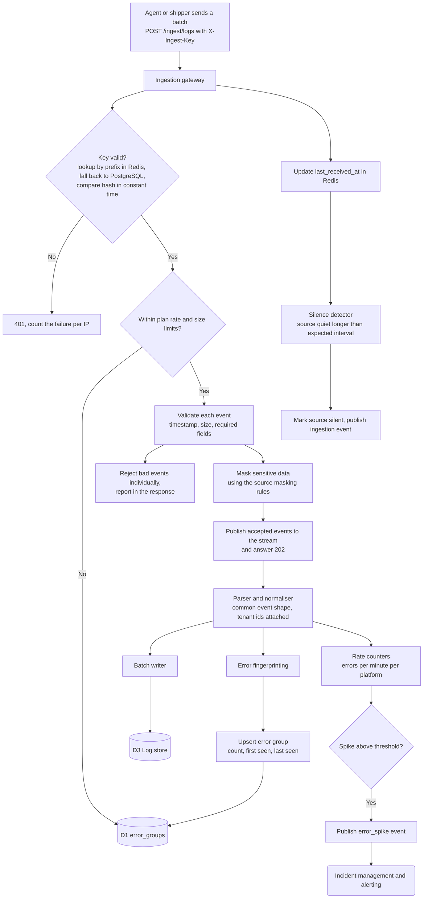

**Notes**

- **Acknowledge early, process later.** The gateway answers `202` once events are safely on the stream. Searchable storage follows within seconds. This keeps the ingestion surface fast under heavy load.
- **Masking happens before anything is stored or queued beyond the gateway**, so sensitive values never reach D3 or the error samples.
- **Backpressure.** If the stream or writer falls behind, the gateway answers `429` or `503`. Agents retry with backoff. Data is never dropped silently.
- **Tenancy.** The key identifies the source, the source identifies the organization, client, and platform. Clients cannot choose their own tenant ids.
- **Tables and stores touched:** `ingestion_sources`, `error_groups`, D3, D5.

### 5.7 Inbound webhooks from other tools (P8)

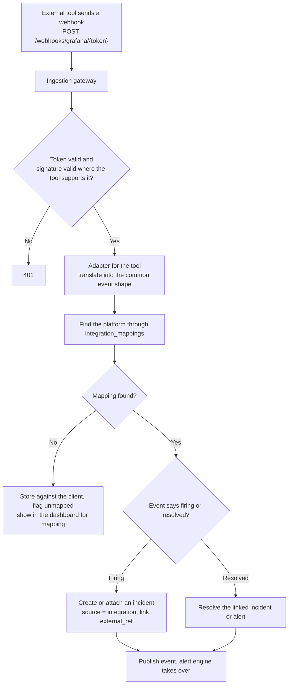

**Notes:** An unmapped event is never discarded. Duplicate deliveries are recognised through the external reference and ignored. **Tables touched:** `integrations`, `integration_mappings`, `incidents`, `alerts`.

### 5.8 Heartbeat (cron job) monitoring (P2 and P6)

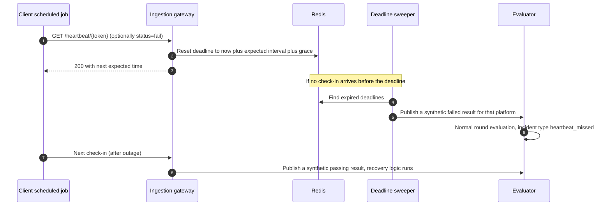

A check-in with `status=fail` is treated as an immediate failed result. Deadlines live in Redis for speed and are rebuilt from `platforms` after a Redis restart, so a cache loss never silences monitors.

### 5.9 Maintenance windows

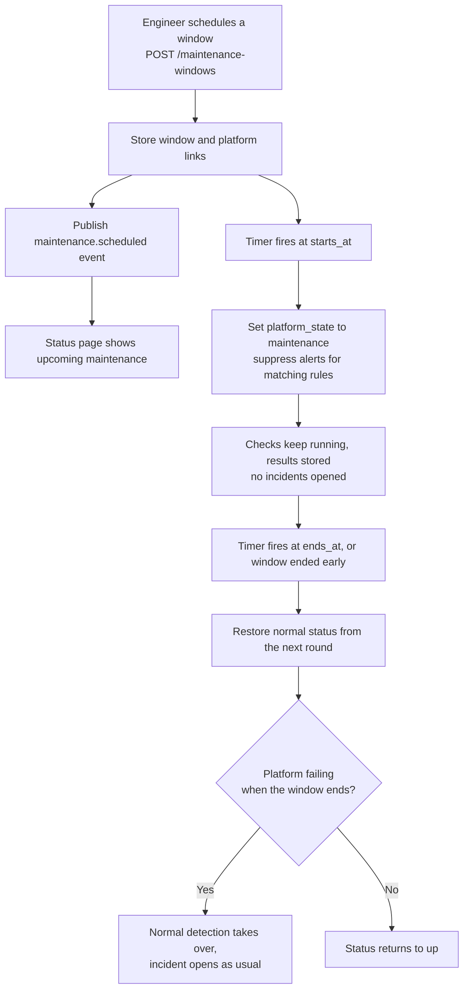

Time spent in a window is excluded from official uptime (see `schema.md` section 10), so planned work never counts against an SLA. A window can never be created in the past.

### 5.10 Status page publication (P7)

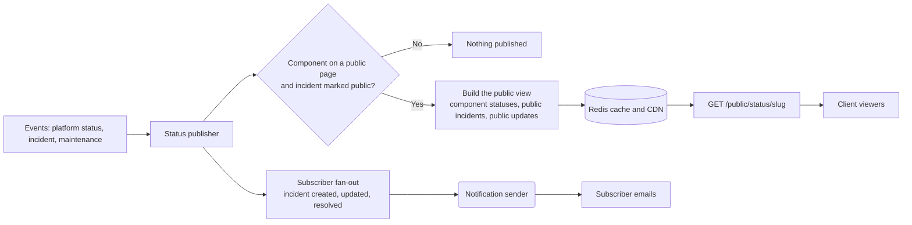

**Notes**

- The public view is a **projection**: it contains only fields deliberately marked public. Internal notes, root causes, and error details are never copied into it.
- The cache is purged when a status or incident event arrives, and also expires after 30 seconds, so a missed purge self-heals.
- Subscriber emails use double opt-in and a signed unsubscribe link.
- **Tables touched:** `status_pages`, `status_page_components`, `status_page_subscribers`, `incidents`, `incident_updates`.

### 5.11 Report generation (P7)

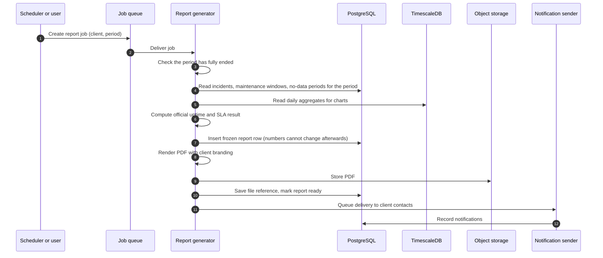

Official uptime follows the formula in `schema.md` section 10 (incident downtime, minus approved maintenance and no-data time). The generator never recomputes a delivered report. A correction creates a new report that references the old one.

### 5.12 Outgoing webhooks (P8)

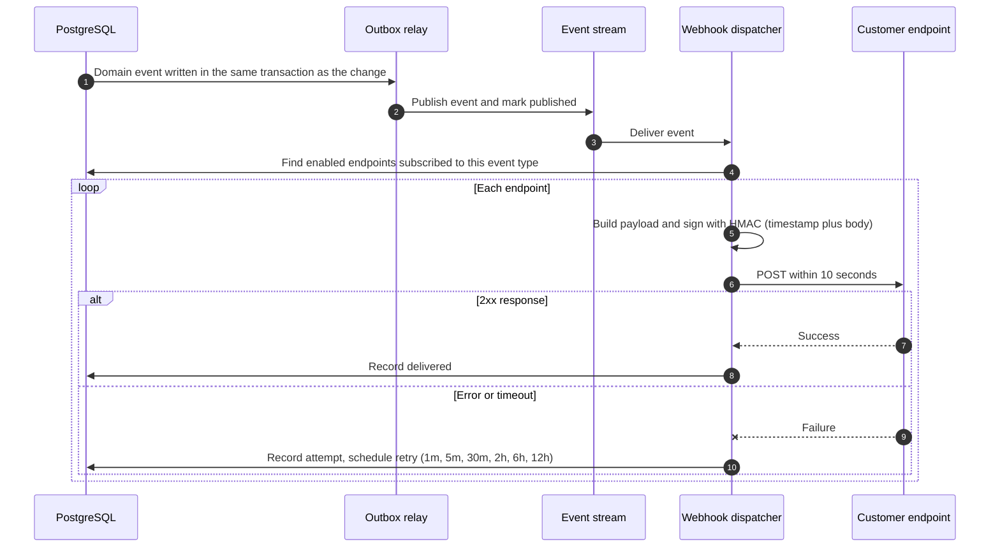

### 5.13 Transactional outbox (how events stay consistent)

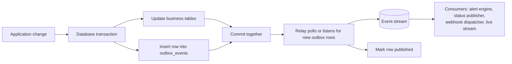

Consumers must be **idempotent**: the relay delivers at least once. Each event carries a unique id, and consumers keep a short record of ids they have handled.

### 5.14 Authentication and sessions

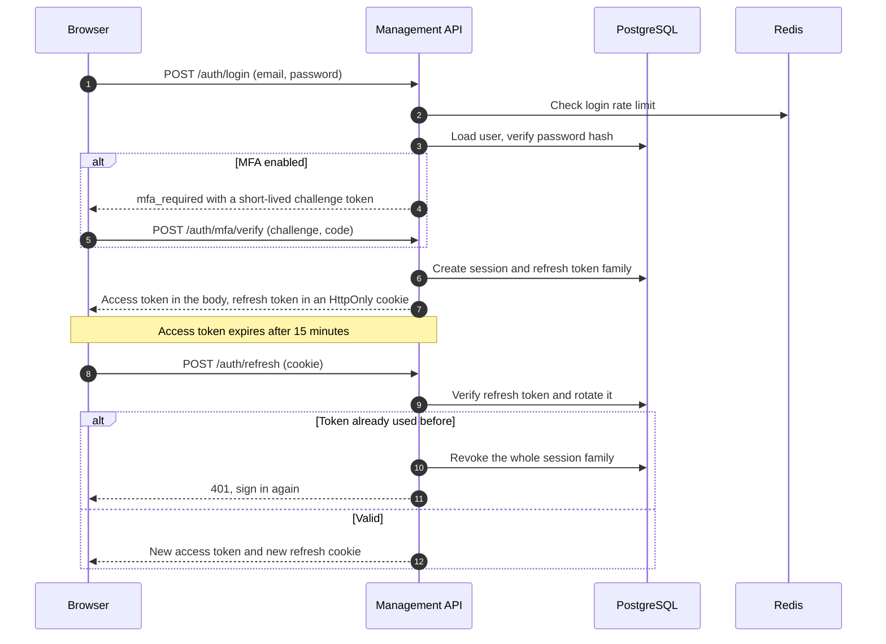

**Tables touched:** `users`, `sessions` (new), `auth_tokens` (new), `organization_members`.

### 5.15 Tenant-isolated request (every Management API call)

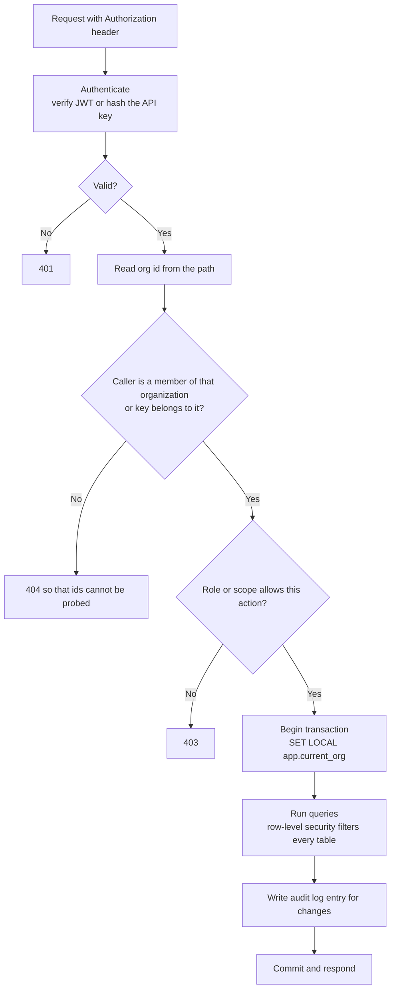

Two independent checks (the membership check and row-level security) must both fail before data could leak. This is deliberate.

### 5.16 Onboarding a client platform (end to end)

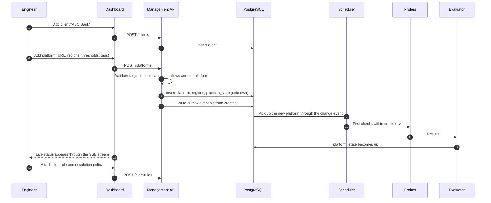

### 5.17 Watching the watcher (our own reliability)

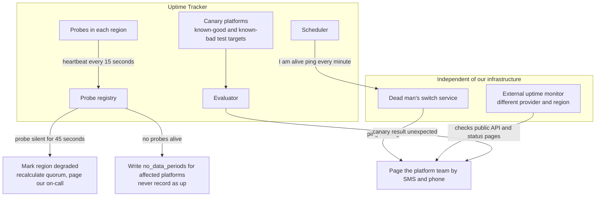

**Why this exists:** a monitoring tool that fails silently is worse than none. Three layers cover three failure kinds: a probe region dying (registry), our whole control plane dying (dead man's switch), and a logic bug producing wrong results (canaries with known answers). Our own paging path must not depend on the systems being watched.

---

## 6. State machines

### 6.1 Platform status

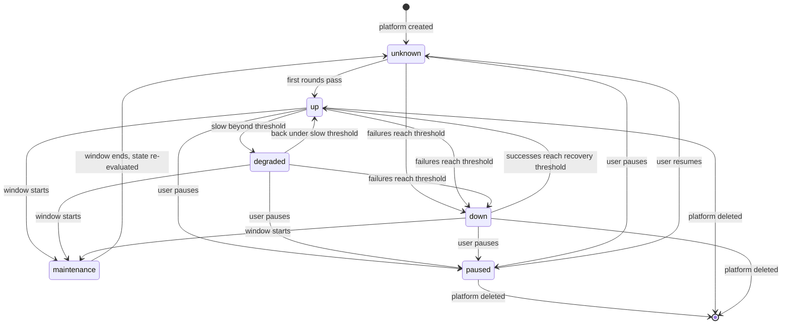

### 6.2 Incident status

```mermaid
stateDiagram-v2
    [*] --> investigating: opened by system or person
    investigating --> identified: cause found
    identified --> monitoring: fix applied
    investigating --> monitoring: recovery seen
    monitoring --> resolved: recovery confirmed
    identified --> resolved: recovery confirmed
    investigating --> resolved: recovery confirmed
    resolved --> investigating: reopened within 24 hours
```

Status only moves forward, except through `reopen`. `resolved` always sets `resolved_at`, and nothing else may (enforced by a database CHECK).

### 6.3 Alert status

```mermaid
stateDiagram-v2
    [*] --> firing: rule matched and not duplicate
    firing --> acknowledged: person acknowledges
    firing --> resolved: incident resolves
    acknowledged --> resolved: incident resolves or person resolves
    firing --> suppressed: maintenance begins
    suppressed --> firing: maintenance ends and problem persists
    suppressed --> resolved: problem gone
    resolved --> [*]
```

### 6.4 Notification status

```mermaid
stateDiagram-v2
    [*] --> queued: created by alert engine
    queued --> sent: provider accepted
    queued --> failed: retries exhausted
    sent --> delivered: receipt received
    sent --> bounced: bounce or invalid destination
    sent --> failed: no receipt and provider error
    failed --> [*]
    delivered --> [*]
    bounced --> [*]
```

A `failed` or `bounced` notification triggers immediate escalation to the next step and raises an internal warning when it affects a critical alert.

### 6.5 Ingestion source status

```mermaid
stateDiagram-v2
    [*] --> waiting: source created
    waiting --> connected: first valid data received
    connected --> silent: nothing for longer than expected interval
    silent --> connected: data resumes
    connected --> disabled: user disables
    silent --> disabled: user disables
    waiting --> disabled: user disables
    disabled --> waiting: user re-enables
```

---

## 7. Where data lives

| Data | Written by | Store | Read by | Retention |
|---|---|---|---|---|
| Accounts, clients, platforms, rules | P1 | D1 | All processes | Until deleted, then purged after the grace period |
| Current platform status | P3 | D1 (`platform_state`) | Dashboard, P5, P7 | Always current |
| Raw check results | P3 | D2 | Dashboard charts, P7 | 30 to 365 days by plan, compressed after 7 |
| Daily summaries | D2 aggregation job | D2 | Reports, long charts | Indefinitely |
| Incidents and timelines | P4 | D1 | Dashboard, P5, P7 | Indefinitely |
| Alerts and notifications | P5 | D1 | Dashboard, audit | 2 years |
| Logs and error events | P6 | D3 | Dashboard log search | 7 to 30 days by plan |
| Grouped errors | P6 | D1 | Dashboard | Until resolved, then 90 days |
| In-flight events and jobs | P2, P3, P4, P6, P8 | D4 | Consumers | Hours to days (replay window) |
| Heartbeat deadlines, rate limits, key cache | P6, gateway | D5 | P6, gateway | Seconds to minutes. Rebuildable from D1 |
| Public status views | P7 | D5 and CDN | Public API | 30 seconds |
| Report files | P7 | D6 | Dashboard, email | Indefinitely |
| Audit trail | P1 and all writers | D1 | Admins | 2 years or more |
| Secrets (keys, credentials) | P1, P8 | D1, encrypted or hashed | Only the process that needs them | Until rotated or deleted |

**Rule of thumb:** anything that cannot be rebuilt (configuration, incidents, reports, audit) lives in D1, D2, or D6 with backups. Anything rebuildable (caches, deadlines, projections) lives in D5. Anything high-volume and disposable (logs) lives in D3 with a short TTL.

---

## 8. Failure and backpressure behaviour

| Failure | Immediate effect | Designed response | How it is detected |
|---|---|---|---|
| One probe machine dies | Some checks missed | Other probes in the region take over. Duplicates are discarded | Registry heartbeat |
| A whole probe region dies | Rounds have fewer results | Region excluded, quorum recalculated, rounds below quorum are inconclusive and recorded as gaps | Registry heartbeat |
| All probes down | No new results | `no_data_periods` written, never counted as up. Internal page | Dead man's switch, canaries |
| Event stream slow or down | Results queue up | Probes buffer locally and retry. Gateway answers `503` with `Retry-After` for ingestion | Stream lag metrics |
| Evaluator crashes mid-round | Round not applied | Consumer group redelivers. Evaluation is idempotent per round | Consumer lag, restarts |
| PostgreSQL primary fails | Config writes fail | Automatic failover to replica. Probes keep running from cached config. Evaluator pauses state changes and resumes | Health checks, replication monitoring |
| TimescaleDB write path slow | Result inserts back up | Batched writes with a bounded buffer. State evaluation continues from the stream, not from the stored rows | Insert latency metrics |
| Redis lost | Caches and deadlines gone | Rebuilt from D1. Auth falls back to the database. Heartbeat deadlines recomputed | Redis health |
| Notification provider down | Messages fail | Retry, switch to backup provider, escalate to the next step | Delivery failure rate |
| All notification channels fail | Nobody is told | Page through the independent path (dead man's switch service) and show a banner in the dashboard | Notification failure alarms |
| Log store down | Logs not searchable | Ingestion keeps accepting into the stream (bounded). Log search shows a clear "temporarily unavailable" state | Writer errors |
| Outbox relay down | Downstream not notified | Rows stay in the outbox. On restart, delivery resumes. Nothing is lost | Outbox age metric |
| Duplicate event delivery | Possible double action | Idempotent consumers using event ids | Duplicate counters |
| Clock skew on a probe | Misordered timestamps | Probes sync time and the evaluator uses its own receive time as a sanity bound. Results far from receive time are flagged | Skew metric |

**Principle:** under every failure, the system prefers saying "we do not know" (a recorded gap) over saying "up".

---

## 9. Timing targets

| Measure | Target | How it is achieved |
|---|---|---|
| Check scheduling accuracy | Within 1 second of the planned tick | Distributed scheduler, per-region job queues |
| Real outage to confirmed incident | Under 60 seconds at a 30-second interval, under 2 minutes at a 60-second interval | Several regions per tick plus fast confirmation rounds |
| Confirmed incident to first notification sent | Under 10 seconds | Event stream to alert engine to sender, no polling on the hot path |
| Notification sent to provider acceptance | Under 5 seconds | Pre-warmed provider connections |
| Escalation timing error | Under 15 seconds | Worker polls the due-alerts index every few seconds |
| Dashboard status update after a change | Under 3 seconds | Live stream (SSE) |
| Public status page update | Under 30 seconds | Cache purge on event, 30-second expiry |
| Ingested log searchable | Under 30 seconds | Small writer batches |
| Heartbeat miss to incident | Expected interval plus grace plus one round | Deadline sweeper |
| Recovery detection | Recovery threshold times the check interval, or faster with confirmation rounds | Same round logic as failure |

These are design targets. They become service level objectives for Uptime Tracker itself once measured, and are reported on our own status page.

---

## 10. Traceability: flows to schema and API

| Flow | Main tables | Main endpoints |
|---|---|---|
| 5.1 Check pipeline | `platforms`, `platform_regions`, `check_results` | `POST /platforms`, `GET /platforms/{id}/check-results` |
| 5.2 Detection | `platform_state`, `incidents`, `no_data_periods` | `GET /platforms/{id}/state`, `GET /incidents` |
| 5.4 Incident lifecycle | `incidents`, `incident_platforms`, `incident_updates` | `/incidents/*` |
| 5.5 Alerting | `alert_rules`, `alerts`, `notifications`, `escalation_*`, `on_call_*` | `/alert-rules`, `/alerts`, `/escalation-policies`, `/on-call/*` |
| 5.6 Log ingestion | `ingestion_sources`, `error_groups`, D3 | `POST /ingest/logs`, `/ingestion-sources`, `/error-groups` |
| 5.7 Inbound webhooks | `integrations`, `integration_mappings` | `/webhooks/*/{token}`, `/integrations` |
| 5.8 Heartbeats | `platforms` (heartbeat type), D5 | `GET /heartbeat/{token}` |
| 5.9 Maintenance | `maintenance_windows`, `maintenance_window_platforms` | `/maintenance-windows` |
| 5.10 Status pages | `status_pages`, `status_page_components`, `status_page_subscribers` | `/public/status/*`, `/status-pages` |
| 5.11 Reports | `reports`, `report_schedules`, `jobs` (new) | `/reports`, `/jobs/{id}` |
| 5.12 Outgoing webhooks | `webhook_endpoints`, `webhook_deliveries` (new) | `/webhook-endpoints` |
| 5.14 Authentication | `users`, `sessions` (new), `auth_tokens` (new) | `/auth/*`, `/me` |
| 5.15 Tenant isolation | all tenant tables (RLS) | every Management API endpoint |

---

## 11. Assumptions made in these flows

1. Probes run in separate regions and hosting providers from the control plane.
2. Evaluation works on **rounds** (all regions for one tick), which the schema already supports through `region_quorum` and the per-platform thresholds.
3. An event stream (NATS or Kafka) sits between probes, evaluator, and downstream consumers. Direct database polling is used only for schedules and escalation timers.
4. State changes publish events through a transactional outbox.
5. During maintenance, incidents are **not** opened and alerts are suppressed, but checks continue and results are stored.
6. Confirmation rounds after a first failure are allowed to run faster than the platform's normal interval.

---

## 12. Schema additions required by these flows

These extend the list in `api_contract.md` section 18.

| # | Addition | Needed for |
|---|---|---|
| 1 | `outbox_events` (id, organization_id, type, payload, created_at, published_at) with an index on unpublished rows | Transactional outbox (5.13) |
| 2 | `processed_events` or a Redis-based dedup record for consumers | Idempotent consumers (5.13) |
| 3 | `platform_baselines` (platform_id, hour_of_week, mean, spread, sample_count, updated_at) | Anomaly detection (5.3) |
| 4 | `probe_instances` (id, region_id, status, last_heartbeat_at, version) | Probe registry (5.17) |
| 5 | `canary_platforms` (platform_id, expected_status, owner) or a flag on `platforms` | Canary monitors (5.17) |
| 6 | `round_evaluations` (optional audit table: platform_id, tick, regions_reported, regions_failed, outcome) | Debugging "why did this open an incident?", short retention |
| 7 | `platforms.confirmation_interval_seconds` (nullable override) | Confirmation round spacing (5.2) |

---

## 13. Open decisions

| # | Decision | Options | Needed by |
|---|---|---|---|
| 1 | Event stream technology | NATS (simple, light) or Kafka (heavy, durable, large scale) | Stage 2 |
| 2 | Scheduler design | Single leader with failover, or sharded schedulers by platform hash | Stage 2 |
| 3 | Where evaluation runs | One stateless evaluator fleet reading the stream, or per-shard evaluators | Stage 2 |
| 4 | Whether round evaluations are persisted | Always, sampled, or only around incidents | Stage 3 |
| 5 | Confirmation round spacing and cap | 10 to 15 seconds, up to the failure threshold | Stage 2 |
| 6 | Whether maintenance should still record incidents silently | No (as drafted), or record with a maintenance flag | Stage 3 |
| 7 | SSE vs WebSocket for the live dashboard | SSE (as drafted) | Stage 4 |
| 8 | Log store | ClickHouse or Loki | Stage 5 |
| 9 | Dead man's switch and external monitor providers | Choose two independent providers | Stage 2 |
| 10 | Anomaly detection starting method | Seasonal baseline, then evaluate models | Stage 7 |
| 11 | Public status page hosting | Same API behind a CDN, or a separate static publisher | Stage 4 |

---

## 14. Change log

| Version | Date | Change |
|---|---|---|
| 0.1 | 2026-11-12 | First full draft |