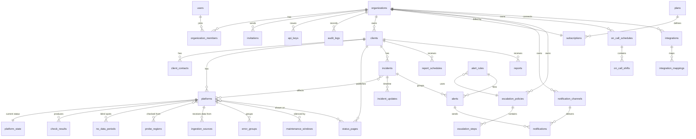

# Uptime Tracker: Database Schema

| | |
|---|---|
| **Version** | 0.1 (draft) |
| **Status** | For review |
| **Database** | PostgreSQL 16 + TimescaleDB |
| **Log store** | ClickHouse or Loki (decision pending, see section 14) |
| **Companion docs** | `app_concept.md` |
| **Next docs** | API contract, flow diagrams, security plan |

---

## 1. Purpose and scope

This document defines the persistent data model of Uptime Tracker: tables, constraints, indexes, tenant isolation, retention, and the rules that keep reported numbers trustworthy.

**In scope:** every PostgreSQL table, the time-series design, the shape of log events, access roles, and migrations.
**Out of scope:** API endpoints, application code, infrastructure sizing.

---

## 2. Design principles

1. **Tenant isolation in two layers.** Every business table carries `organization_id`. Application code filters by it, and PostgreSQL row-level security (RLS) enforces it, so an application bug cannot leak data between consultancies.
2. **Composite foreign keys on tenant data.** Child tables reference `(organization_id, id)` of their parent. A row can therefore never point at another organization's parent, even by mistake.
3. **UTC everywhere.** All timestamps are `timestamptz` and converted to a time zone only for display.
4. **UUID primary keys.** Safe to expose in URLs and not guessable. Human-friendly numbers (for example `INC-1042`) are separate columns.
5. **Configuration, state, and events are separate.**
   - `platforms` is configuration (what to watch).
   - `platform_state` is the current status (one row per platform).
   - `check_results` is the immutable event history (millions of rows).
6. **Time-series data is partitioned by time.** Raw rows are compressed and then dropped by a retention policy. Long-term reporting reads from continuous aggregates.
7. **Soft delete** (`deleted_at`) on user-managed entities, so history and reports stay valid.
8. **Secrets are hashed or encrypted.** Passwords, API keys, ingestion keys, and invitation tokens are stored as hashes. Credentials inside JSON settings are encrypted by the application before storage.
9. **The audit trail is append-only.**
10. **Honest numbers.** Our own blind spots are recorded as "no data" and never counted as "up" (see section 10).

---

## 3. Entity relationship diagram



---

## 4. Conventions

| Item | Rule |
|---|---|
| Table names | plural `snake_case` |
| Primary key | `id uuid DEFAULT gen_random_uuid()` |
| Foreign key columns | `<singular_table>_id` |
| Timestamps | `created_at`, `updated_at` (maintained by trigger), `deleted_at` where soft delete applies |
| Enums | PostgreSQL enum types, all defined in migration 0001 |
| Flexible settings | `jsonb`, only where the shape varies by type |
| Tenant column | `organization_id uuid NOT NULL` on every tenant-owned table, including child tables |
| Composite foreign keys | Parents expose `UNIQUE (organization_id, id)` so children can reference it |
| Migrations | Numbered, forward-only files (`0001_*.sql`), applied by a migration tool in CI |
| Naming of constraints | Default PostgreSQL names unless a name is needed for an error message |

---

## 5. Migrations

### 0001: Foundations (extensions, enums, helpers)

```sql
CREATE EXTENSION IF NOT EXISTS citext;
CREATE EXTENSION IF NOT EXISTS timescaledb;

-- Tenancy and identity
CREATE TYPE org_status          AS ENUM ('active', 'suspended', 'closed');
CREATE TYPE member_role         AS ENUM ('owner', 'admin', 'engineer', 'viewer', 'billing');

-- Monitoring
CREATE TYPE check_type          AS ENUM ('http', 'keyword', 'api', 'tcp', 'ping', 'dns',
                                         'ssl', 'domain', 'heartbeat', 'browser', 'transaction');
CREATE TYPE platform_status     AS ENUM ('unknown', 'up', 'degraded', 'down', 'maintenance', 'paused');
CREATE TYPE error_category      AS ENUM ('dns', 'connection_refused', 'timeout', 'tls',
                                         'bad_status', 'content_mismatch', 'slow', 'other');
CREATE TYPE no_data_reason      AS ENUM ('tracker_outage', 'probe_outage', 'paused');

-- Incidents
CREATE TYPE severity_level      AS ENUM ('info', 'minor', 'major', 'critical');
CREATE TYPE incident_type       AS ENUM ('downtime', 'degraded', 'anomaly', 'error_spike',
                                         'ssl_expiry', 'heartbeat_missed', 'manual');
CREATE TYPE incident_status     AS ENUM ('investigating', 'identified', 'monitoring', 'resolved');
CREATE TYPE incident_source     AS ENUM ('automatic', 'manual', 'integration');
CREATE TYPE impact_level        AS ENUM ('degraded', 'outage');
CREATE TYPE update_kind         AS ENUM ('system_event', 'status_change', 'note', 'public_update');

-- Alerting
CREATE TYPE rule_scope          AS ENUM ('platform', 'client', 'organization', 'tag');
CREATE TYPE condition_type      AS ENUM ('consecutive_failures', 'response_time', 'error_rate',
                                         'anomaly', 'ssl_expiry_days', 'heartbeat_missed', 'no_data');
CREATE TYPE channel_type        AS ENUM ('email', 'sms', 'whatsapp', 'slack', 'teams', 'push', 'voice', 'webhook');
CREATE TYPE target_type         AS ENUM ('user', 'channel', 'schedule');
CREATE TYPE alert_status        AS ENUM ('firing', 'acknowledged', 'resolved', 'suppressed');
CREATE TYPE notification_status AS ENUM ('queued', 'sent', 'delivered', 'failed', 'bounced');
CREATE TYPE notification_kind   AS ENUM ('alert', 'reminder', 'recovery', 'report', 'status_update');
CREATE TYPE rotation_type       AS ENUM ('daily', 'weekly', 'custom');

-- Client data and integrations
CREATE TYPE ingestion_type      AS ENUM ('log_shipper', 'webhook', 'error_sdk', 'syslog', 'cloud_pull', 'loki_pull');
CREATE TYPE ingestion_status    AS ENUM ('waiting', 'connected', 'silent', 'disabled');
CREATE TYPE error_group_status  AS ENUM ('new', 'ongoing', 'resolved', 'ignored');
CREATE TYPE integration_type    AS ENUM ('prometheus', 'grafana', 'loki', 'sentry', 'pagerduty', 'opsgenie',
                                         'jira', 'servicenow', 'slack', 'cloud_aws', 'cloud_azure', 'cloud_gcp');
CREATE TYPE integration_direction AS ENUM ('inbound', 'outbound', 'both');
CREATE TYPE integration_status  AS ENUM ('active', 'error', 'disabled');

-- Reports and billing
CREATE TYPE report_frequency    AS ENUM ('weekly', 'monthly', 'quarterly');
CREATE TYPE subscription_status AS ENUM ('trialing', 'active', 'past_due', 'canceled');
CREATE TYPE billing_period      AS ENUM ('monthly', 'yearly');

-- Keeps updated_at honest. Triggers are attached in migration 0010.
CREATE FUNCTION set_updated_at() RETURNS trigger AS $$
BEGIN
  NEW.updated_at = now();
  RETURN NEW;
END;
$$ LANGUAGE plpgsql;
```

### 0002: Identity and tenancy

```sql
CREATE TABLE organizations (
  id          uuid        PRIMARY KEY DEFAULT gen_random_uuid(),
  name        text        NOT NULL,
  slug        citext      NOT NULL UNIQUE CHECK (slug ~ '^[a-z0-9][a-z0-9-]{2,62}$'),
  timezone    text        NOT NULL DEFAULT 'UTC',
  locale      text        NOT NULL DEFAULT 'en',
  status      org_status  NOT NULL DEFAULT 'active',
  created_at  timestamptz NOT NULL DEFAULT now(),
  updated_at  timestamptz NOT NULL DEFAULT now(),
  deleted_at  timestamptz
);

-- Users live outside organizations: one person can belong to several consultancies.
CREATE TABLE users (
  id                uuid        PRIMARY KEY DEFAULT gen_random_uuid(),
  email             citext      NOT NULL UNIQUE,
  name              text        NOT NULL,
  password_hash     text,                         -- NULL when signing in through SSO
  phone             text,
  mfa_enabled       boolean     NOT NULL DEFAULT false,
  mfa_secret_enc    bytea,
  email_verified_at timestamptz,
  last_login_at     timestamptz,
  created_at        timestamptz NOT NULL DEFAULT now(),
  updated_at        timestamptz NOT NULL DEFAULT now(),
  deleted_at        timestamptz
);

CREATE TABLE organization_members (
  id              uuid        PRIMARY KEY DEFAULT gen_random_uuid(),
  organization_id uuid        NOT NULL REFERENCES organizations(id) ON DELETE CASCADE,
  user_id         uuid        NOT NULL REFERENCES users(id) ON DELETE CASCADE,
  role            member_role NOT NULL,
  created_at      timestamptz NOT NULL DEFAULT now(),
  UNIQUE (organization_id, user_id)
);
CREATE INDEX ON organization_members (user_id);

CREATE TABLE invitations (
  id              uuid        PRIMARY KEY DEFAULT gen_random_uuid(),
  organization_id uuid        NOT NULL REFERENCES organizations(id) ON DELETE CASCADE,
  email           citext      NOT NULL,
  role            member_role NOT NULL,
  token_hash      text        NOT NULL UNIQUE,
  invited_by      uuid        NOT NULL REFERENCES users(id),
  expires_at      timestamptz NOT NULL,
  accepted_at     timestamptz,
  created_at      timestamptz NOT NULL DEFAULT now()
);
CREATE INDEX ON invitations (organization_id);

CREATE TABLE api_keys (
  id              uuid        PRIMARY KEY DEFAULT gen_random_uuid(),
  organization_id uuid        NOT NULL REFERENCES organizations(id) ON DELETE CASCADE,
  name            text        NOT NULL,
  key_prefix      text        NOT NULL,           -- shown in the UI, e.g. 'ut_live_a1b2'
  key_hash        text        NOT NULL UNIQUE,    -- the full key is never stored
  scopes          text[]      NOT NULL DEFAULT '{}',
  created_by      uuid        NOT NULL REFERENCES users(id),
  last_used_at    timestamptz,
  expires_at      timestamptz,
  revoked_at      timestamptz,
  created_at      timestamptz NOT NULL DEFAULT now()
);
CREATE INDEX ON api_keys (organization_id);

-- Append-only: the application role receives INSERT and SELECT only (see section 12).
CREATE TABLE audit_logs (
  id               bigint      GENERATED ALWAYS AS IDENTITY PRIMARY KEY,
  organization_id  uuid        NOT NULL,
  actor_user_id    uuid,
  actor_api_key_id uuid,
  action           text        NOT NULL,          -- e.g. 'platform.deleted'
  entity_type      text        NOT NULL,
  entity_id        uuid,
  before_state     jsonb,
  after_state      jsonb,
  ip_address       inet,
  user_agent       text,
  created_at       timestamptz NOT NULL DEFAULT now()
);
CREATE INDEX ON audit_logs (organization_id, created_at DESC);
CREATE INDEX ON audit_logs (organization_id, entity_type, entity_id);
```

### 0003: Clients and monitoring configuration

```sql
CREATE TABLE clients (
  id                 uuid         PRIMARY KEY DEFAULT gen_random_uuid(),
  organization_id    uuid         NOT NULL REFERENCES organizations(id) ON DELETE CASCADE,
  name               text         NOT NULL,
  external_ref       text,                         -- the consultancy's own client code
  sla_target_percent numeric(5,3) CHECK (sla_target_percent BETWEEN 0 AND 100),
  notes              text,
  created_at         timestamptz  NOT NULL DEFAULT now(),
  updated_at         timestamptz  NOT NULL DEFAULT now(),
  deleted_at         timestamptz,
  UNIQUE (organization_id, id)                     -- target for composite foreign keys
);
CREATE UNIQUE INDEX clients_name_uq ON clients (organization_id, lower(name)) WHERE deleted_at IS NULL;

CREATE TABLE client_contacts (
  id                        uuid        PRIMARY KEY DEFAULT gen_random_uuid(),
  organization_id           uuid        NOT NULL,
  client_id                 uuid        NOT NULL,
  name                      text        NOT NULL,
  email                     citext,
  phone                     text,
  receives_reports          boolean     NOT NULL DEFAULT false,
  receives_incident_updates boolean     NOT NULL DEFAULT false,
  created_at                timestamptz NOT NULL DEFAULT now(),
  FOREIGN KEY (organization_id, client_id) REFERENCES clients (organization_id, id) ON DELETE CASCADE,
  CHECK (email IS NOT NULL OR phone IS NOT NULL)
);
CREATE INDEX ON client_contacts (organization_id, client_id);

-- Global reference data, not tenant-owned.
CREATE TABLE probe_regions (
  id        uuid    PRIMARY KEY DEFAULT gen_random_uuid(),
  code      text    NOT NULL UNIQUE,               -- 'rw-kigali', 'ke-nairobi', 'eu-frankfurt'
  name      text    NOT NULL,
  provider  text    NOT NULL,
  is_active boolean NOT NULL DEFAULT true
);

CREATE TABLE platforms (
  id                 uuid        PRIMARY KEY DEFAULT gen_random_uuid(),
  organization_id    uuid        NOT NULL,
  client_id          uuid        NOT NULL,
  name               text        NOT NULL,
  check_type         check_type  NOT NULL,
  target             text        NOT NULL,         -- URL, host, or domain depending on type
  config             jsonb       NOT NULL DEFAULT '{}',   -- type-specific settings; secrets inside are encrypted
  interval_seconds   integer     NOT NULL DEFAULT 60 CHECK (interval_seconds BETWEEN 10 AND 86400),
  timeout_seconds    integer     NOT NULL DEFAULT 10 CHECK (timeout_seconds BETWEEN 1 AND 120),
  failure_threshold  smallint    NOT NULL DEFAULT 3  CHECK (failure_threshold  >= 1),
  recovery_threshold smallint    NOT NULL DEFAULT 2  CHECK (recovery_threshold >= 1),
  region_quorum      smallint    NOT NULL DEFAULT 2  CHECK (region_quorum      >= 1),
  slow_threshold_ms  integer     CHECK (slow_threshold_ms > 0),
  follow_redirects   boolean     NOT NULL DEFAULT true,
  is_active          boolean     NOT NULL DEFAULT true,
  paused_until       timestamptz,
  tags               text[]      NOT NULL DEFAULT '{}',
  created_by         uuid        REFERENCES users(id),
  created_at         timestamptz NOT NULL DEFAULT now(),
  updated_at         timestamptz NOT NULL DEFAULT now(),
  deleted_at         timestamptz,
  UNIQUE (organization_id, id),
  FOREIGN KEY (organization_id, client_id) REFERENCES clients (organization_id, id),
  CHECK (timeout_seconds < interval_seconds)
);
CREATE INDEX platforms_client_idx ON platforms (organization_id, client_id) WHERE deleted_at IS NULL;
CREATE INDEX platforms_tags_idx   ON platforms USING gin (tags);
CREATE INDEX platforms_active_idx ON platforms (is_active) WHERE deleted_at IS NULL;   -- scheduler scan

CREATE TABLE platform_regions (
  organization_id uuid NOT NULL,
  platform_id     uuid NOT NULL,
  probe_region_id uuid NOT NULL REFERENCES probe_regions(id),
  PRIMARY KEY (platform_id, probe_region_id),
  FOREIGN KEY (organization_id, platform_id) REFERENCES platforms (organization_id, id) ON DELETE CASCADE
);

-- One row per platform: the current truth. Dashboards read this table, never the raw history.
CREATE TABLE platform_state (
  platform_id           uuid            PRIMARY KEY,
  organization_id       uuid            NOT NULL,
  status                platform_status NOT NULL DEFAULT 'unknown',
  status_since          timestamptz     NOT NULL DEFAULT now(),
  last_check_at         timestamptz,
  last_success_at       timestamptz,
  consecutive_failures  integer         NOT NULL DEFAULT 0,
  consecutive_successes integer         NOT NULL DEFAULT 0,
  open_incident_id      uuid,                      -- foreign key added in migration 0005
  last_response_ms      integer,
  ssl_expires_at        timestamptz,
  updated_at            timestamptz     NOT NULL DEFAULT now(),
  FOREIGN KEY (organization_id, platform_id) REFERENCES platforms (organization_id, id) ON DELETE CASCADE
);
CREATE INDEX ON platform_state (organization_id, status);
```

### 0004: Check results (time-series)

```sql
-- Deliberately NO foreign keys: this table takes the heaviest write load and
-- foreign key checks on every insert are expensive. Integrity is enforced by the
-- probe pipeline, which only emits results for known platforms.
CREATE TABLE check_results (
  platform_id         uuid          NOT NULL,
  probe_region_id     uuid          NOT NULL,
  checked_at          timestamptz   NOT NULL,
  organization_id     uuid          NOT NULL,
  is_up               boolean       NOT NULL,
  response_time_ms    integer,
  status_code         smallint,
  error_category      error_category,
  error_message       text,
  timings             jsonb,                       -- dns, connect, tls, ttfb, transfer
  response_size_bytes integer,
  ssl_expires_at      timestamptz,
  content_matched     boolean,
  probe_id            text,
  PRIMARY KEY (platform_id, probe_region_id, checked_at)
);

SELECT create_hypertable('check_results', 'checked_at', chunk_time_interval => INTERVAL '1 day');

CREATE INDEX ON check_results (platform_id, checked_at DESC);
CREATE INDEX ON check_results (organization_id, checked_at DESC);

ALTER TABLE check_results SET (
  timescaledb.compress,
  timescaledb.compress_segmentby = 'platform_id, probe_region_id',
  timescaledb.compress_orderby   = 'checked_at DESC'
);
SELECT add_compression_policy('check_results', INTERVAL '7 days');
-- Upper bound for the whole system. Shorter per-plan retention is enforced by a scheduled job.
SELECT add_retention_policy('check_results', INTERVAL '365 days');

-- Daily summary: kept long term, powers charts and report drafts.
CREATE MATERIALIZED VIEW check_results_daily
WITH (timescaledb.continuous) AS
SELECT
  platform_id,
  organization_id,
  time_bucket(INTERVAL '1 day', checked_at)           AS day,
  count(*)                                            AS total_checks,
  sum(CASE WHEN is_up THEN 1 ELSE 0 END)              AS successful_checks,
  avg(response_time_ms)                               AS avg_response_ms,
  min(response_time_ms)                               AS min_response_ms,
  max(response_time_ms)                               AS max_response_ms
FROM check_results
GROUP BY platform_id, organization_id, time_bucket(INTERVAL '1 day', checked_at)
WITH NO DATA;

SELECT add_continuous_aggregate_policy('check_results_daily',
  start_offset      => INTERVAL '3 days',
  end_offset        => INTERVAL '1 hour',
  schedule_interval => INTERVAL '1 hour');

-- Periods where WE were blind. They must appear as "no data" in reports, never as "up".
CREATE TABLE no_data_periods (
  id              uuid           PRIMARY KEY DEFAULT gen_random_uuid(),
  organization_id uuid           NOT NULL,
  platform_id     uuid           NOT NULL,
  started_at      timestamptz    NOT NULL,
  ended_at        timestamptz,
  reason          no_data_reason NOT NULL,
  FOREIGN KEY (organization_id, platform_id) REFERENCES platforms (organization_id, id) ON DELETE CASCADE,
  CHECK (ended_at IS NULL OR ended_at >= started_at)
);
CREATE INDEX ON no_data_periods (platform_id, started_at DESC);
```

### 0005: Incidents

```sql
-- Gap-free per-organization numbering (INC-1, INC-2, ...).
CREATE TABLE organization_counters (
  organization_id uuid    NOT NULL REFERENCES organizations(id) ON DELETE CASCADE,
  name            text    NOT NULL,                -- 'incident'
  value           integer NOT NULL DEFAULT 0,
  PRIMARY KEY (organization_id, name)
);

CREATE FUNCTION next_org_number(p_org uuid, p_name text) RETURNS integer AS $$
  INSERT INTO organization_counters (organization_id, name, value)
  VALUES (p_org, p_name, 1)
  ON CONFLICT (organization_id, name)
  DO UPDATE SET value = organization_counters.value + 1
  RETURNING value;
$$ LANGUAGE sql;

CREATE TABLE incidents (
  id                 uuid            PRIMARY KEY DEFAULT gen_random_uuid(),
  organization_id    uuid            NOT NULL,
  client_id          uuid            NOT NULL,
  number             integer         NOT NULL,
  title              text            NOT NULL,
  type               incident_type   NOT NULL,
  severity           severity_level  NOT NULL,
  status             incident_status NOT NULL DEFAULT 'investigating',
  source             incident_source NOT NULL DEFAULT 'automatic',
  started_at         timestamptz     NOT NULL,     -- first failed check, for honest reporting
  detected_at        timestamptz     NOT NULL,     -- when multi-region consensus confirmed it
  acknowledged_at    timestamptz,
  acknowledged_by    uuid            REFERENCES users(id),
  resolved_at        timestamptz,
  root_cause         text,
  resolution_summary text,
  is_public          boolean         NOT NULL DEFAULT false,
  external_ref       text,                         -- e.g. ticket ID in another tool
  created_by         uuid            REFERENCES users(id),
  created_at         timestamptz     NOT NULL DEFAULT now(),
  updated_at         timestamptz     NOT NULL DEFAULT now(),
  UNIQUE (organization_id, id),
  UNIQUE (organization_id, number),
  FOREIGN KEY (organization_id, client_id) REFERENCES clients (organization_id, id),
  CHECK (detected_at >= started_at),
  CHECK (resolved_at IS NULL OR resolved_at >= started_at),
  CHECK ((status = 'resolved') = (resolved_at IS NOT NULL))
);
CREATE INDEX incidents_open_idx   ON incidents (organization_id, started_at DESC) WHERE status <> 'resolved';
CREATE INDEX incidents_client_idx ON incidents (client_id, started_at DESC);

-- An incident can affect several platforms; a platform can have many incidents.
CREATE TABLE incident_platforms (
  organization_id uuid         NOT NULL,
  incident_id     uuid         NOT NULL,
  platform_id     uuid         NOT NULL,
  impact          impact_level NOT NULL DEFAULT 'outage',
  PRIMARY KEY (incident_id, platform_id),
  FOREIGN KEY (organization_id, incident_id) REFERENCES incidents (organization_id, id) ON DELETE CASCADE,
  FOREIGN KEY (organization_id, platform_id) REFERENCES platforms (organization_id, id)
);
CREATE INDEX ON incident_platforms (platform_id);

CREATE TABLE incident_updates (
  id              uuid            PRIMARY KEY DEFAULT gen_random_uuid(),
  organization_id uuid            NOT NULL,
  incident_id     uuid            NOT NULL,
  author_user_id  uuid            REFERENCES users(id),     -- NULL = system
  kind            update_kind     NOT NULL,
  body            text            NOT NULL,
  new_status      incident_status,
  is_public       boolean         NOT NULL DEFAULT false,
  created_at      timestamptz     NOT NULL DEFAULT now(),
  FOREIGN KEY (organization_id, incident_id) REFERENCES incidents (organization_id, id) ON DELETE CASCADE
);
CREATE INDEX ON incident_updates (incident_id, created_at);

-- Close the loop opened in platform_state.
ALTER TABLE platform_state
  ADD CONSTRAINT platform_state_open_incident_fk
  FOREIGN KEY (organization_id, open_incident_id) REFERENCES incidents (organization_id, id);
```

### 0006: Alerting and notifications

```sql
CREATE TABLE notification_channels (
  id              uuid         PRIMARY KEY DEFAULT gen_random_uuid(),
  organization_id uuid         NOT NULL REFERENCES organizations(id) ON DELETE CASCADE,
  type            channel_type NOT NULL,
  name            text         NOT NULL,
  destination     text         NOT NULL,           -- address, number, or webhook URL
  config          jsonb        NOT NULL DEFAULT '{}',   -- encrypted tokens, templates
  verified_at     timestamptz,
  is_active       boolean      NOT NULL DEFAULT true,
  created_at      timestamptz  NOT NULL DEFAULT now(),
  updated_at      timestamptz  NOT NULL DEFAULT now(),
  deleted_at      timestamptz,
  UNIQUE (organization_id, id)
);

CREATE TABLE on_call_schedules (
  id              uuid          PRIMARY KEY DEFAULT gen_random_uuid(),
  organization_id uuid          NOT NULL REFERENCES organizations(id) ON DELETE CASCADE,
  name            text          NOT NULL,
  timezone        text          NOT NULL DEFAULT 'UTC',
  rotation_type   rotation_type NOT NULL DEFAULT 'weekly',
  created_at      timestamptz   NOT NULL DEFAULT now(),
  updated_at      timestamptz   NOT NULL DEFAULT now(),
  UNIQUE (organization_id, id)
);

-- Shifts are stored explicitly, so "who is on call right now?" is a simple lookup.
CREATE TABLE on_call_shifts (
  id              uuid        PRIMARY KEY DEFAULT gen_random_uuid(),
  organization_id uuid        NOT NULL,
  schedule_id     uuid        NOT NULL,
  user_id         uuid        NOT NULL REFERENCES users(id),
  starts_at       timestamptz NOT NULL,
  ends_at         timestamptz NOT NULL,
  is_override     boolean     NOT NULL DEFAULT false,
  FOREIGN KEY (organization_id, schedule_id) REFERENCES on_call_schedules (organization_id, id) ON DELETE CASCADE,
  CHECK (ends_at > starts_at)
);
CREATE INDEX ON on_call_shifts (schedule_id, starts_at, ends_at);

CREATE TABLE escalation_policies (
  id              uuid        PRIMARY KEY DEFAULT gen_random_uuid(),
  organization_id uuid        NOT NULL REFERENCES organizations(id) ON DELETE CASCADE,
  name            text        NOT NULL,
  repeat_count    smallint    NOT NULL DEFAULT 0 CHECK (repeat_count >= 0),
  created_at      timestamptz NOT NULL DEFAULT now(),
  updated_at      timestamptz NOT NULL DEFAULT now(),
  UNIQUE (organization_id, id)
);

CREATE TABLE escalation_steps (
  id                   uuid        PRIMARY KEY DEFAULT gen_random_uuid(),
  organization_id      uuid        NOT NULL,
  escalation_policy_id uuid        NOT NULL,
  step_order           smallint    NOT NULL CHECK (step_order >= 1),
  delay_minutes        integer     NOT NULL DEFAULT 0 CHECK (delay_minutes >= 0),
  target_type          target_type NOT NULL,
  target_user_id       uuid        REFERENCES users(id),
  target_channel_id    uuid,
  target_schedule_id   uuid,
  UNIQUE (escalation_policy_id, step_order),
  FOREIGN KEY (organization_id, escalation_policy_id) REFERENCES escalation_policies (organization_id, id) ON DELETE CASCADE,
  FOREIGN KEY (organization_id, target_channel_id)    REFERENCES notification_channels (organization_id, id),
  FOREIGN KEY (organization_id, target_schedule_id)   REFERENCES on_call_schedules (organization_id, id),
  -- Exactly one target column, matching target_type, must be set.
  CHECK (
    (target_type = 'user'     AND target_user_id     IS NOT NULL AND target_channel_id IS NULL     AND target_schedule_id IS NULL) OR
    (target_type = 'channel'  AND target_channel_id  IS NOT NULL AND target_user_id    IS NULL     AND target_schedule_id IS NULL) OR
    (target_type = 'schedule' AND target_schedule_id IS NOT NULL AND target_user_id    IS NULL     AND target_channel_id  IS NULL)
  )
);

CREATE TABLE alert_rules (
  id                   uuid           PRIMARY KEY DEFAULT gen_random_uuid(),
  organization_id      uuid           NOT NULL,
  name                 text           NOT NULL,
  scope                rule_scope     NOT NULL,
  platform_id          uuid,
  client_id            uuid,
  tag                  text,
  condition_type       condition_type NOT NULL,
  condition_config     jsonb          NOT NULL DEFAULT '{}',   -- e.g. {"threshold_ms": 3000, "duration_min": 5}
  severity             severity_level NOT NULL,
  escalation_policy_id uuid           NOT NULL,
  cooldown_minutes     integer        NOT NULL DEFAULT 30 CHECK (cooldown_minutes >= 0),
  respect_maintenance  boolean        NOT NULL DEFAULT true,
  is_enabled           boolean        NOT NULL DEFAULT true,
  created_at           timestamptz    NOT NULL DEFAULT now(),
  updated_at           timestamptz    NOT NULL DEFAULT now(),
  deleted_at           timestamptz,
  UNIQUE (organization_id, id),
  FOREIGN KEY (organization_id, platform_id)          REFERENCES platforms (organization_id, id),
  FOREIGN KEY (organization_id, client_id)            REFERENCES clients (organization_id, id),
  FOREIGN KEY (organization_id, escalation_policy_id) REFERENCES escalation_policies (organization_id, id),
  -- The scope decides which target column must be filled.
  CHECK (
    (scope = 'platform'     AND platform_id IS NOT NULL AND client_id IS NULL     AND tag IS NULL)     OR
    (scope = 'client'       AND client_id   IS NOT NULL AND platform_id IS NULL   AND tag IS NULL)     OR
    (scope = 'tag'          AND tag         IS NOT NULL AND platform_id IS NULL   AND client_id IS NULL) OR
    (scope = 'organization' AND platform_id IS NULL     AND client_id IS NULL     AND tag IS NULL)
  )
);
CREATE INDEX ON alert_rules (organization_id, scope) WHERE deleted_at IS NULL AND is_enabled;
CREATE INDEX ON alert_rules (platform_id) WHERE platform_id IS NOT NULL;

-- A fired alert (as opposed to the rule that can fire it).
CREATE TABLE alerts (
  id                 uuid           PRIMARY KEY DEFAULT gen_random_uuid(),
  organization_id    uuid           NOT NULL,
  alert_rule_id      uuid           NOT NULL,
  incident_id        uuid,
  platform_id        uuid           NOT NULL,
  dedup_key          text           NOT NULL,      -- same key = same ongoing alert
  status             alert_status   NOT NULL DEFAULT 'firing',
  severity           severity_level NOT NULL,
  summary            text           NOT NULL,
  current_step       smallint       NOT NULL DEFAULT 0,
  fired_at           timestamptz    NOT NULL DEFAULT now(),
  acknowledged_at    timestamptz,
  acknowledged_by    uuid           REFERENCES users(id),
  resolved_at        timestamptz,
  last_notified_at   timestamptz,
  next_escalation_at timestamptz,
  UNIQUE (organization_id, id),
  FOREIGN KEY (organization_id, alert_rule_id) REFERENCES alert_rules (organization_id, id),
  FOREIGN KEY (organization_id, incident_id)   REFERENCES incidents (organization_id, id),
  FOREIGN KEY (organization_id, platform_id)   REFERENCES platforms (organization_id, id)
);
-- Prevents 50 duplicate alerts for one outage.
CREATE UNIQUE INDEX alerts_active_dedup_uq
  ON alerts (organization_id, dedup_key) WHERE status IN ('firing', 'acknowledged', 'suppressed');
-- The escalation worker scans only alerts that are due.
CREATE INDEX alerts_due_idx      ON alerts (next_escalation_at) WHERE status = 'firing';
CREATE INDEX alerts_incident_idx ON alerts (incident_id);

-- Every message actually sent: the proof that people were warned.
CREATE TABLE notifications (
  id                  uuid                PRIMARY KEY DEFAULT gen_random_uuid(),
  organization_id     uuid                NOT NULL,
  alert_id            uuid,
  incident_id         uuid,
  channel_id          uuid                NOT NULL,
  recipient_user_id   uuid                REFERENCES users(id),
  escalation_step_id  uuid                REFERENCES escalation_steps(id),
  kind                notification_kind   NOT NULL,
  status              notification_status NOT NULL DEFAULT 'queued',
  provider            text,
  provider_message_id text,
  error_message       text,
  attempt             smallint            NOT NULL DEFAULT 1,
  queued_at           timestamptz         NOT NULL DEFAULT now(),
  sent_at             timestamptz,
  delivered_at        timestamptz,
  FOREIGN KEY (organization_id, alert_id)    REFERENCES alerts (organization_id, id),
  FOREIGN KEY (organization_id, incident_id) REFERENCES incidents (organization_id, id),
  FOREIGN KEY (organization_id, channel_id)  REFERENCES notification_channels (organization_id, id)
);
CREATE INDEX ON notifications (alert_id);
CREATE INDEX ON notifications (organization_id, queued_at DESC);
CREATE INDEX ON notifications (channel_id, sent_at DESC);
CREATE INDEX notifications_pending_idx ON notifications (queued_at) WHERE status = 'queued';
```

### 0007: Maintenance windows

```sql
CREATE TABLE maintenance_windows (
  id                  uuid        PRIMARY KEY DEFAULT gen_random_uuid(),
  organization_id     uuid        NOT NULL,
  client_id           uuid,                        -- NULL when it targets specific platforms only
  title               text        NOT NULL,
  starts_at           timestamptz NOT NULL,
  ends_at             timestamptz NOT NULL,
  recurrence_rule     text,                        -- standard recurrence string, NULL for one-off
  suppress_alerts     boolean     NOT NULL DEFAULT true,
  show_on_status_page boolean     NOT NULL DEFAULT true,
  created_by          uuid        REFERENCES users(id),
  created_at          timestamptz NOT NULL DEFAULT now(),
  UNIQUE (organization_id, id),
  FOREIGN KEY (organization_id, client_id) REFERENCES clients (organization_id, id),
  CHECK (ends_at > starts_at)
);
CREATE INDEX ON maintenance_windows (organization_id, starts_at, ends_at);

CREATE TABLE maintenance_window_platforms (
  organization_id       uuid NOT NULL,
  maintenance_window_id uuid NOT NULL,
  platform_id           uuid NOT NULL,
  PRIMARY KEY (maintenance_window_id, platform_id),
  FOREIGN KEY (organization_id, maintenance_window_id) REFERENCES maintenance_windows (organization_id, id) ON DELETE CASCADE,
  FOREIGN KEY (organization_id, platform_id)           REFERENCES platforms (organization_id, id) ON DELETE CASCADE
);
CREATE INDEX ON maintenance_window_platforms (platform_id);
```

### 0008: Client-facing layer (status pages, reports)

```sql
CREATE TABLE status_pages (
  id              uuid        PRIMARY KEY DEFAULT gen_random_uuid(),
  organization_id uuid        NOT NULL,
  client_id       uuid        NOT NULL,
  slug            citext      NOT NULL UNIQUE,
  custom_domain   citext      UNIQUE,
  title           text        NOT NULL,
  branding        jsonb       NOT NULL DEFAULT '{}',   -- logo, colours
  is_public       boolean     NOT NULL DEFAULT true,
  created_at      timestamptz NOT NULL DEFAULT now(),
  updated_at      timestamptz NOT NULL DEFAULT now(),
  UNIQUE (organization_id, id),
  FOREIGN KEY (organization_id, client_id) REFERENCES clients (organization_id, id)
);

CREATE TABLE status_page_components (
  id              uuid     PRIMARY KEY DEFAULT gen_random_uuid(),
  organization_id uuid     NOT NULL,
  status_page_id  uuid     NOT NULL,
  platform_id     uuid     NOT NULL,
  display_name    text     NOT NULL,
  sort_order      smallint NOT NULL DEFAULT 0,
  UNIQUE (status_page_id, platform_id),
  FOREIGN KEY (organization_id, status_page_id) REFERENCES status_pages (organization_id, id) ON DELETE CASCADE,
  FOREIGN KEY (organization_id, platform_id)    REFERENCES platforms (organization_id, id) ON DELETE CASCADE
);

CREATE TABLE status_page_subscribers (
  id                     uuid        PRIMARY KEY DEFAULT gen_random_uuid(),
  organization_id        uuid        NOT NULL,
  status_page_id         uuid        NOT NULL,
  email                  citext      NOT NULL,
  verified_at            timestamptz,
  unsubscribe_token_hash text        NOT NULL,
  created_at             timestamptz NOT NULL DEFAULT now(),
  UNIQUE (status_page_id, email),
  FOREIGN KEY (organization_id, status_page_id) REFERENCES status_pages (organization_id, id) ON DELETE CASCADE
);

CREATE TABLE report_schedules (
  id                uuid             PRIMARY KEY DEFAULT gen_random_uuid(),
  organization_id   uuid             NOT NULL,
  client_id         uuid             NOT NULL,
  frequency         report_frequency NOT NULL,
  send_day          smallint         NOT NULL,       -- day of week or month, depending on frequency
  recipients_mode   text             NOT NULL DEFAULT 'client_contacts' CHECK (recipients_mode IN ('client_contacts', 'custom')),
  custom_recipients text[]           NOT NULL DEFAULT '{}',
  template          jsonb            NOT NULL DEFAULT '{}',
  is_active         boolean          NOT NULL DEFAULT true,
  created_at        timestamptz      NOT NULL DEFAULT now(),
  FOREIGN KEY (organization_id, client_id) REFERENCES clients (organization_id, id) ON DELETE CASCADE
);

-- Numbers are FROZEN at generation time, so an old report never changes.
CREATE TABLE reports (
  id                     uuid         PRIMARY KEY DEFAULT gen_random_uuid(),
  organization_id        uuid         NOT NULL,
  client_id              uuid         NOT NULL,
  period_start           date         NOT NULL,
  period_end             date         NOT NULL,
  generated_at           timestamptz  NOT NULL DEFAULT now(),
  uptime_percent         numeric(7,4) NOT NULL,
  sla_target_percent     numeric(5,3),
  sla_met                boolean,
  total_downtime_seconds integer      NOT NULL,
  no_data_seconds        integer      NOT NULL DEFAULT 0,
  incident_count         integer      NOT NULL,
  summary_data           jsonb        NOT NULL DEFAULT '{}',
  file_reference         text,                       -- storage key of the generated PDF
  sent_at                timestamptz,
  UNIQUE (client_id, period_start, period_end),
  FOREIGN KEY (organization_id, client_id) REFERENCES clients (organization_id, id),
  CHECK (period_end >= period_start)
);
```

### 0009: Client data, integrations, billing

```sql
CREATE TABLE ingestion_sources (
  id                        uuid             PRIMARY KEY DEFAULT gen_random_uuid(),
  organization_id           uuid             NOT NULL,
  client_id                 uuid             NOT NULL,
  platform_id               uuid,                    -- NULL if the source covers a whole client
  type                      ingestion_type   NOT NULL,
  name                      text             NOT NULL,
  key_prefix                text             NOT NULL,
  key_hash                  text             NOT NULL UNIQUE,   -- authenticates incoming data
  config                    jsonb            NOT NULL DEFAULT '{}',   -- parsing, masking, filters
  expected_interval_seconds integer          CHECK (expected_interval_seconds > 0),
  last_received_at          timestamptz,
  status                    ingestion_status NOT NULL DEFAULT 'waiting',
  created_at                timestamptz      NOT NULL DEFAULT now(),
  updated_at                timestamptz      NOT NULL DEFAULT now(),
  FOREIGN KEY (organization_id, client_id)   REFERENCES clients (organization_id, id),
  FOREIGN KEY (organization_id, platform_id) REFERENCES platforms (organization_id, id)
);
CREATE INDEX ON ingestion_sources (key_prefix);
CREATE INDEX ON ingestion_sources (organization_id, status);

-- 5,000 identical errors become one row with a count.
CREATE TABLE error_groups (
  id               uuid               PRIMARY KEY DEFAULT gen_random_uuid(),
  organization_id  uuid               NOT NULL,
  platform_id      uuid               NOT NULL,
  fingerprint      text               NOT NULL,      -- hash of the error's identity
  title            text               NOT NULL,
  first_seen_at    timestamptz        NOT NULL,
  last_seen_at     timestamptz        NOT NULL,
  occurrence_count bigint             NOT NULL DEFAULT 1,
  status           error_group_status NOT NULL DEFAULT 'new',
  last_sample      jsonb,
  UNIQUE (platform_id, fingerprint),
  FOREIGN KEY (organization_id, platform_id) REFERENCES platforms (organization_id, id) ON DELETE CASCADE
);
CREATE INDEX ON error_groups (organization_id, status, last_seen_at DESC);

CREATE TABLE integrations (
  id                uuid                  PRIMARY KEY DEFAULT gen_random_uuid(),
  organization_id   uuid                  NOT NULL REFERENCES organizations(id) ON DELETE CASCADE,
  type              integration_type      NOT NULL,
  name              text                  NOT NULL,
  direction         integration_direction NOT NULL,
  connection_config jsonb                 NOT NULL DEFAULT '{}',   -- credentials encrypted
  status            integration_status    NOT NULL DEFAULT 'active',
  last_sync_at      timestamptz,
  last_error        text,
  created_at        timestamptz           NOT NULL DEFAULT now(),
  updated_at        timestamptz           NOT NULL DEFAULT now(),
  UNIQUE (organization_id, id)
);

-- Lets an incoming Grafana or Sentry event land on the right platform.
CREATE TABLE integration_mappings (
  id              uuid PRIMARY KEY DEFAULT gen_random_uuid(),
  organization_id uuid NOT NULL,
  integration_id  uuid NOT NULL,
  platform_id     uuid NOT NULL,
  external_id     text NOT NULL,
  UNIQUE (integration_id, external_id),
  FOREIGN KEY (organization_id, integration_id) REFERENCES integrations (organization_id, id) ON DELETE CASCADE,
  FOREIGN KEY (organization_id, platform_id)    REFERENCES platforms (organization_id, id) ON DELETE CASCADE
);

-- Global reference data.
CREATE TABLE plans (
  id            uuid          PRIMARY KEY DEFAULT gen_random_uuid(),
  code          text          NOT NULL UNIQUE,     -- 'starter', 'growth', 'pro'
  name          text          NOT NULL,
  price_monthly numeric(10,2) NOT NULL,
  price_yearly  numeric(10,2) NOT NULL,
  currency      char(3)       NOT NULL DEFAULT 'USD',
  limits        jsonb         NOT NULL,            -- max platforms, min interval, regions, retention, seats
  is_active     boolean       NOT NULL DEFAULT true
);

CREATE TABLE subscriptions (
  id                       uuid                PRIMARY KEY DEFAULT gen_random_uuid(),
  organization_id          uuid                NOT NULL UNIQUE REFERENCES organizations(id) ON DELETE CASCADE,
  plan_id                  uuid                NOT NULL REFERENCES plans(id),
  status                   subscription_status NOT NULL,
  billing_period           billing_period      NOT NULL,
  current_period_start     timestamptz         NOT NULL,
  current_period_end       timestamptz         NOT NULL,
  trial_ends_at            timestamptz,
  cancel_at_period_end     boolean             NOT NULL DEFAULT false,
  payment_provider         text,
  provider_customer_id     text,
  provider_subscription_id text,
  created_at               timestamptz         NOT NULL DEFAULT now(),
  updated_at               timestamptz         NOT NULL DEFAULT now()
);
-- Card details are never stored: the payment provider holds them.

CREATE TABLE usage_records (
  id              uuid        PRIMARY KEY DEFAULT gen_random_uuid(),
  organization_id uuid        NOT NULL REFERENCES organizations(id) ON DELETE CASCADE,
  metric          text        NOT NULL CHECK (metric IN ('platforms', 'checks', 'sms_sent', 'whatsapp_sent', 'log_gb')),
  period_start    timestamptz NOT NULL,
  period_end      timestamptz NOT NULL,
  quantity        numeric     NOT NULL,
  UNIQUE (organization_id, metric, period_start)
);
```

### 0010: Triggers, row-level security, roles

```sql
-- 1. updated_at triggers
DO $$
DECLARE t text;
BEGIN
  FOREACH t IN ARRAY ARRAY[
    'organizations', 'users', 'clients', 'platforms', 'platform_state', 'incidents',
    'notification_channels', 'on_call_schedules', 'escalation_policies', 'alert_rules',
    'status_pages', 'ingestion_sources', 'integrations', 'subscriptions'
  ] LOOP
    EXECUTE format(
      'CREATE TRIGGER %I_set_updated_at BEFORE UPDATE ON %I FOR EACH ROW EXECUTE FUNCTION set_updated_at()', t, t);
  END LOOP;
END $$;

-- 2. Row-level security on every tenant table.
--    The API sets the tenant per request:  SET LOCAL app.current_org = '<uuid>';
DO $$
DECLARE t text;
BEGIN
  FOREACH t IN ARRAY ARRAY[
    'organization_members', 'invitations', 'api_keys', 'audit_logs', 'clients', 'client_contacts',
    'platforms', 'platform_regions', 'platform_state', 'no_data_periods',
    'incidents', 'incident_platforms', 'incident_updates', 'organization_counters',
    'notification_channels', 'on_call_schedules', 'on_call_shifts', 'escalation_policies',
    'escalation_steps', 'alert_rules', 'alerts', 'notifications',
    'maintenance_windows', 'maintenance_window_platforms',
    'status_pages', 'status_page_components', 'status_page_subscribers',
    'report_schedules', 'reports', 'ingestion_sources', 'error_groups',
    'integrations', 'integration_mappings', 'subscriptions', 'usage_records'
  ] LOOP
    EXECUTE format('ALTER TABLE %I ENABLE ROW LEVEL SECURITY', t);
    EXECUTE format('ALTER TABLE %I FORCE ROW LEVEL SECURITY', t);
    EXECUTE format($p$
      CREATE POLICY tenant_isolation ON %I
        USING      (organization_id = current_setting('app.current_org', true)::uuid)
        WITH CHECK (organization_id = current_setting('app.current_org', true)::uuid)
    $p$, t);
  END LOOP;
END $$;

-- organizations is isolated by its own id.
ALTER TABLE organizations ENABLE ROW LEVEL SECURITY;
ALTER TABLE organizations FORCE ROW LEVEL SECURITY;
CREATE POLICY tenant_isolation ON organizations
  USING (id = current_setting('app.current_org', true)::uuid);

-- 3. Roles (least privilege). Passwords are set outside this file.
CREATE ROLE app_api     LOGIN;                 -- the web API
CREATE ROLE app_worker  LOGIN BYPASSRLS;       -- scheduler, evaluator, alert engine (cross-tenant by design)
CREATE ROLE app_probe   LOGIN;                 -- probes: write check results only
CREATE ROLE app_report  LOGIN;                 -- report generator: read-mostly

GRANT USAGE ON SCHEMA public TO app_api, app_worker, app_probe, app_report;

GRANT SELECT, INSERT, UPDATE, DELETE ON ALL TABLES IN SCHEMA public TO app_api, app_worker;
REVOKE UPDATE, DELETE ON audit_logs FROM app_api, app_worker;     -- append-only
GRANT INSERT ON check_results TO app_probe;
GRANT SELECT ON platforms, platform_regions, probe_regions TO app_probe;
GRANT SELECT ON ALL TABLES IN SCHEMA public TO app_report;
GRANT INSERT, UPDATE ON reports TO app_report;
GRANT USAGE ON ALL SEQUENCES IN SCHEMA public TO app_api, app_worker;
```

> **Note on `check_results` and RLS.** `check_results` is intentionally excluded from the RLS list. TimescaleDB compression and row-level security do not combine on the same hypertable in some versions, so verify this against the version you deploy. Tenant isolation for this table is enforced in the data-access layer, which always filters by `organization_id`, and customer-facing reads never run with `app_worker` credentials.

---

## 6. Log and error event store (outside PostgreSQL)

Raw logs and error events are far larger than check results, so they live in a column store (ClickHouse or Loki) and not in PostgreSQL. Every source (log shipper, webhook, SDK, cloud pull) is converted into one common event shape before storage.

| Field | Type | Meaning |
|---|---|---|
| `organization_id` | uuid | Tenant, used in every query |
| `client_id` | uuid | Owning client |
| `platform_id` | uuid | Platform the event belongs to |
| `ingestion_source_id` | uuid | Where it came from |
| `event_time` | datetime64 (UTC) | When it happened on the client's side |
| `received_at` | datetime64 (UTC) | When Uptime Tracker received it |
| `source_type` | enum | `access_log`, `error_log`, `app_log`, `system_log`, `webhook`, `error_event` |
| `severity` | enum | `debug`, `info`, `warning`, `error`, `critical` |
| `message` | string | Text after sensitive-data masking |
| `fields` | map | Parsed fields (status code, path, latency, user agent) |
| `trace_id` | string | Optional link between related events |
| `fingerprint` | string | For errors: links to `error_groups.fingerprint` |

Storage rules:

- Partition by month, order by `(organization_id, platform_id, event_time)`.
- Retention follows the plan (default 7 to 30 days) through a TTL setting.
- Masking of passwords, tokens, and personal data happens **before** the event is written, using the rules in `ingestion_sources.config`.
- `error_groups` in PostgreSQL stores only the grouped summary, never raw events.

---

## 7. Indexing strategy

| Table | Index | Query it serves |
|---|---|---|
| `check_results` | `(platform_id, checked_at DESC)` | Charts and uptime for one platform |
| `check_results` | `(organization_id, checked_at DESC)` | Organization-wide recent activity |
| `platforms` | `(organization_id, client_id) WHERE deleted_at IS NULL` | Listing a client's platforms |
| `platforms` | `(is_active) WHERE deleted_at IS NULL` | Scheduler scan |
| `platforms` | GIN on `tags` | Tag-scoped alert rules and filtering |
| `platform_state` | `(organization_id, status)` | "Show everything that is down" |
| `incidents` | `(organization_id, started_at DESC) WHERE status <> 'resolved'` | Open incidents list |
| `incidents` | `(client_id, started_at DESC)` | Client history and reports |
| `alerts` | unique `(organization_id, dedup_key)` on active statuses | Deduplication |
| `alerts` | `(next_escalation_at) WHERE status = 'firing'` | Escalation worker |
| `notifications` | `(alert_id)`, `(channel_id, sent_at DESC)` | Delivery history |
| `notifications` | `(queued_at) WHERE status = 'queued'` | Sender queue |
| `audit_logs` | `(organization_id, created_at DESC)` | Audit review |
| `ingestion_sources` | `(key_prefix)` | Authenticating incoming data quickly |

Indexes beyond this list should be added only when a slow query proves the need.

---

## 8. Key access patterns

| Need | Source | Notes |
|---|---|---|
| Current status of every platform | `platform_state` | One row per platform, never scans history |
| Response-time chart, last 24 hours | `check_results` | Time-bounded, uses the platform and time index |
| Response-time chart, last 90 days | `check_results_daily` | Pre-aggregated |
| Open incidents | `incidents` partial index | Small, hot set |
| Who is on call now | `on_call_shifts` | Range lookup on one schedule |
| Alerts due for escalation | `alerts_due_idx` | Worker polls by time |
| Deduplicate a new alert | `alerts_active_dedup_uq` | Insert conflicts instead of duplicating |
| Authenticate an agent | `ingestion_sources` by `key_prefix`, then hash comparison | Constant-time compare |
| Monthly SLA report | `incidents` + `maintenance_windows` + `no_data_periods` | See section 10 |

---

## 9. Data lifecycle and retention

| Data | Store | Retention |
|---|---|---|
| Raw check results | `check_results` | Compressed after 7 days. Dropped after the plan limit (30 to 365 days) |
| Daily summaries | `check_results_daily` | Kept indefinitely (tiny) |
| Log and error events | Log store | 7 to 30 days by plan |
| Error groups | `error_groups` | Until resolved, then 90 days |
| Incidents and updates | `incidents`, `incident_updates` | Indefinitely (permanent record) |
| Notifications | `notifications` | 2 years |
| Audit logs | `audit_logs` | 2 years minimum |
| Reports | `reports` and file storage | Indefinitely |
| Soft-deleted rows | Original tables | Purged 30 days after `deleted_at`, along with dependent rows |
| Closed organizations | All tables | Exported on request, purged 90 days after closure |

---

## 10. Reporting integrity rules

These rules protect the credibility of every number shown to clients.

1. **Official uptime comes from incidents, not raw checks.**
   `uptime % = (period − confirmed downtime − approved maintenance − no-data time) ÷ (period − approved maintenance − no-data time) × 100`
   Confirmed downtime is the sum of `resolved_at − started_at` for `downtime`-type incidents, clipped to the period.
2. **The raw ratio `successful_checks ÷ total_checks` is for charts only.** One region's network hiccup is not downtime.
3. **`started_at` is the first failed check**, not the moment consensus was reached, so reports do not flatter us.
4. **Our own outages are `no_data_periods`.** They are subtracted from both sides of the formula and shown separately in reports.
5. **Maintenance counts only when approved** (inside a `maintenance_windows` row with `suppress_alerts = true`).
6. **Reports are frozen.** `reports` stores the computed numbers, so later data corrections never silently change a delivered report.
7. **Failed checks are never sampled out.** Retention may drop old rows, but ingestion never discards failures.

---

## 11. Key invariants (enforced in the database)

| Invariant | Mechanism |
|---|---|
| A row never references another organization's parent | Composite foreign keys on `(organization_id, id)` |
| One open alert per dedup key | Partial unique index on `alerts` |
| An incident is resolved if and only if it has a `resolved_at` | CHECK constraint on `incidents` |
| An escalation step has exactly one target, matching its type | CHECK constraint on `escalation_steps` |
| An alert rule's scope matches the column that is filled | CHECK constraint on `alert_rules` |
| Check timeout is shorter than the check interval | CHECK constraint on `platforms` |
| Incident numbers are unique per organization | `UNIQUE (organization_id, number)` plus `next_org_number()` |
| Audit logs cannot be altered | Privileges revoked on UPDATE and DELETE |
| Tenants cannot read each other's rows | RLS with `FORCE ROW LEVEL SECURITY` |

Rules the database cannot express and the application must enforce:

- `region_quorum` is at most the number of rows in `platform_regions` for that platform.
- Secrets inside `config`, `connection_config`, and `notification_channels.config` are encrypted before insert.
- `platform_state` is updated in the same transaction that opens or closes an incident.
- Incident numbers are assigned inside the transaction that creates the incident.

---

## 12. Security rules

1. **RLS on every tenant table**, with `FORCE ROW LEVEL SECURITY` so even table owners are subject to it.
2. **Tenant ID on high-volume and child tables** so isolation never depends on joins.
3. **Hash, never store:** passwords, API keys, ingestion keys, invitation tokens, unsubscribe tokens. Only a short prefix is displayed.
4. **Encrypt secrets** in JSON settings columns with an application-managed key, supporting key rotation.
5. **No card data.** The payment provider holds it.
6. **Mask sensitive fields** in logs before storage.
7. **Append-only audit log**, with a separate retention job running under a dedicated role.
8. **Least-privilege roles:** `app_api`, `app_worker`, `app_probe`, `app_report` (migration 0010).
9. **Per-request tenant context:** the API sets `app.current_org` inside each transaction and never reuses a connection with a stale value.
10. **Backups are encrypted**, and restore is tested on a schedule.

---

## 13. Build order for tables

| Stage | Migrations | Tables |
|---|---|---|
| 1. Foundations | 0001, 0002, 0010 | enums, `organizations`, `users`, `organization_members`, `invitations`, `api_keys`, `audit_logs` |
| 2. Core monitoring | 0003, 0004 | `clients`, `client_contacts`, `platforms`, `probe_regions`, `platform_regions`, `platform_state`, `check_results`, `check_results_daily`, `no_data_periods` |
| 3. Incidents and alerts | 0005, 0006, 0007 | `incidents`, `incident_platforms`, `incident_updates`, `organization_counters`, `notification_channels`, `on_call_*`, `escalation_*`, `alert_rules`, `alerts`, `notifications`, `maintenance_*` |
| 4. Client layer | 0008 | `status_pages`, `status_page_components`, `status_page_subscribers`, `report_schedules`, `reports` |
| 5. Deep data | 0009 (part) | `ingestion_sources`, `error_groups`, log store |
| 6. Integrations | 0009 (part) | `integrations`, `integration_mappings` |
| 7. Business | 0009 (part) | `plans`, `subscriptions`, `usage_records` |

Migration 0010 (RLS and roles) is extended in the same stage as each new set of tables, so no tenant table ever exists without isolation.

---

## 14. Open decisions

| # | Decision | Options | Needed by |
|---|---|---|---|
| 1 | Log store | ClickHouse or Loki | Stage 5 |
| 2 | Hosted vs self-managed TimescaleDB | Managed service or own servers | Stage 2 |
| 3 | Can a platform belong to several clients? | Currently no | Stage 2 |
| 4 | Teams or groups inside an organization | Roles only, or add teams | Stage 1 |
| 5 | Grouping of related platform failures into one incident | Automatic rules or manual | Stage 3 |
| 6 | Status page languages | Single or multiple | Stage 4 |
| 7 | Payment providers | Cards, mobile money | Stage 7 |
| 8 | Custom fields on clients and platforms | None, or per-organization fields | Stage 2 |
| 9 | Per-plan retention enforcement | Scheduled job vs separate hypertables | Stage 2 |
| 10 | Schema migration tool | To be chosen with the backend language | Stage 1 |

---

## 15. Change log

| Version | Date | Change |
|---|---|---|
| 0.1 | 2026-11-12 | First full draft |